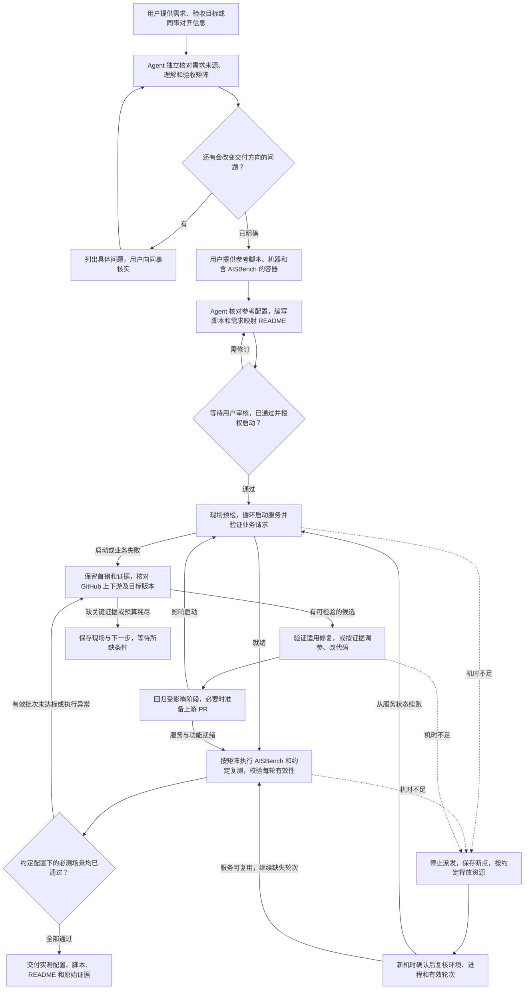

# vLLM 需求交付流程

用于用户希望从需求对齐一路推进至服务部署、AISBench 验收和手动复测的项目。已有服务的单独摸测、数据分析或从已确认断点续跑，按对应入口直接开展。首次启动前对脚本和 README 的审核是本流程的用户检查点，已有明确审核结论时直接引用。

用户可在任一阶段查阅证据、复测或调整方向。涉及验收范围、必开特性、资源预算或外部发布的变化，汇报影响并按用户新指示推进。经审核的范围内，Agent 负责逐轮执行、筛除和回退。

## 开工检查

### 收到需求后

- [ ] **逐条核对理解。** 将用户转述与需求原文、同事口径、已提供的测法和成绩对照。给出「已明确、待确认、有冲突」及各自依据。识别必开特性、仅要求具备的能力、本轮交付范围和前置依赖。
- [ ] **冻结验收矩阵。** 一行一个可判定场景。写清对照对象和出处、模型和特性、请求实际长度、前缀数量与命中范围、并发或到达速率、每轮请求数、预热与正式重复。明确主指标、硬门槛、报告项、有效批次要求，以及哪些场景须用同一最终配置复测。
- [ ] **确定通过范围和取证方式。** 按需求分别定义启动就绪、端到端功能、缓存来源及热回读内容正确性、性能和稳定性证据。提前区分历史参考和可做同条件比较的现场基线，确认比较对象是否允许用不同负载。
- [ ] **把疑点变成可转问同事的问题。** 每个疑点说明依据、两种理解会怎样改变脚本或测试，以及建议找哪类负责人核实。优先确认会改变部署方向或通过判定的少量问题，例如「DCP 是支持项，还是本轮必须开启？」已明确的内容直接沿用。方向未定时可以并行做不依赖答案的资料整理。

### 写脚本和 README 前

- [ ] **取得同事最近跑通的参考。** 尽量拿到同模型、同环境的完整启动命令、角色脚本、容器镜像及版本、所用补丁、成功请求和测试日志。逐项比对待交付配置，标明已实测适用范围。新增参数先核对需求与依赖，避免为可省略开关引入修复分支。
- [ ] **登记机器、镜像和机时。** 确认可用宿主机、容器实例及镜像、卡/角色/网络分配、部署与权重路径、AISBench 执行位置，以及资源归属。约定开始和截止时间及时区、可调范围和资源上限、预留落盘与清理时间、停机或保留目标和恢复条件。现场能核对的事实由 Agent 在授权范围内通过只读预检补齐。
- [ ] **让审核有具体对象。** 给出可执行脚本、相对参考的最小 diff 和 README。README 按「需求或验收条目｜对应脚本、参数或入口｜复测命令和通过判据」逐项映射，并写明机器角色、启动顺序、日志及结果位置和恢复方式。先做可用的静态校验，再请用户审核。审核通过且授权启动后，进入机器开始部署。

### 启动与发压前

- [ ] **核验实际运行条件。** 核对机时仍有效、资源归属、端口和进程、容器内模型/tokenizer 挂载、驱动/CANN/vLLM/插件版本及实际加载代码、并行和连接器角色。既有进程先确认身份及当前状态。按端口、角色和业务请求逐级验证，PD 场景覆盖 P、D 和实际 Proxy。
- [ ] **核验 AISBench 输入和结果路径。** 查当前入口、版本、依赖数据、读写路径、唯一轮次和压测互斥。确认实际请求长度、格式、缓存构建、初始状态和逐条校验方式。先做最小完整业务检查，并在需要热回读正确性时先测冷算与热回读样本。正式轮次使用已确认口径。

## 执行、排障和用户介入

1. **启动闭环。** 按审核版脚本启动。遇到故障，先保留首个有效错误、触发配置、版本、角色/rank 和后续等待，再同已跑通配置比较。优先做能改变判断的最小试验，如在确认参数可省略时用同镜像、同配置去参验证。核对通过后再运行代表性业务请求。
2. **验收与寻优。** 按矩阵逐轮执行 AISBench，逐请求检查长度、成功和输出完整性，保留实际缓存、时延、吞吐及原始证据。测试失败先查业务是否实际执行，再检查客户端、落盘和重跑后的缓存状态。未达门槛时先复现基线，按阶段定位瓶颈。调参时固定负载，分别验证参数主效应和并发交互。无报错时可用阶段耗时、调用链或 profiling 验证执行路径中的重复搬运、同步或其它开销，再用受控对照判断代码优化收益。每轮给出假设、实际改动、筛除条件和回退点。详细方法见[基线劣化诊断与配置寻优](baseline-regression-loop.md)。
3. **复用修复或实现最小改动。** 启动和压测异常都先用脱敏的错误、组件和实际版本查 GitHub 上游及相关下游的 issue、PR、commit、发布分支或回移记录。用目标源码、实际生效版本和测试证据判断适用性。对应修复适用时，以可回退方式验证。缺少适用修复时，再按调用链和证据实现最小改动，保留必要功能与校验，做最小回归和完整验收。需要上游贡献时，备好最小 patch、目标仓库和分支、故障证据、可执行回归及实际效果，按当轮授权提交 PR。缺少可检验假设、预算用尽或需要扩大授权时，保留现场并报告明确的阻点。
4. **让用户能随时复测。** 在目标澄清、README 审核、遇到实质故障、决策改变和交付时，给出当前验收项、关键证据、下一试验会改变的判断及机时预算。用户要在同一服务手动复测时，先协调查验窗口，暂停后续派发，核对运行中批次、服务配置、缓存状态和压测互斥。用户结果按同一有效性判据纳入，并保留其来源。
5. **按矩阵收尾。** 各场景在约定的最终配置上完成正式案例和重复，共用一套配置的场景在同一配置上复测。交付最终脚本、README、命令、逐轮原始数据、指标汇总、已通过和待验证项，以及服务保留或释放状态。README 的启动和复测命令指向实测版本，用户可以独立拉起、验证和复测。

## 机时中断与续跑

- **预计本轮无法在机时内完成时**，按约定停止派发，给结果落盘和清理留出时间。确认当前批次能否收齐，保存有效轮次和中止证据。按已确认范围停止或恢复自有服务，记录实际释放状态，将等待机时标为暂停。
- **把断点留在持久目录。** 至少写清需求与协议版本、最近的用户确认、审核版和当前候选的配置引用、已验证基线与最佳配置、机时及资源映射、已完成和中止轮次、下一待跑阶段/case/轮次、首错与恢复目标、进程/锁和原始产物位置。断点按[执行与续跑](execution-and-recovery.md)维护。
- **获得新机时后续跑。** 确认当期资源与授权，复核机器、镜像、脚本指纹、现有服务及压测进程。核对旧到期锁和定时清理是否属于已结束的机时、确已执行完毕。根据现场判断是否能复用服务和已有轮次，需重启时按协议重新预热或构建缓存，从第一个缺失的有效轮次继续。换机器或改协议时，先判断旧结果可比性并补最小对照。

可直接用下面的格式发起项目。先提供前两项即可进入需求审查，后续资料按阶段补齐。

> 用 `$vllm-perf-experiments` 按需求交付流程处理。
>
> - **需求与同事确认信息**包括原文、我的理解、尚未确定的内容。
> - **验收**包括场景、必开功能、基线、主指标、门槛和报告项。
> - **参考与资源**包括已跑通的脚本或命令、机器、包含 AISBench 的容器、可用卡和机时。
>
> 先独立审查我的理解，给出可转问同事的问题。需求明确后，写脚本和 README 供我审核。审核通过后，自主部署、压测和优化。机时中断时保存断点，重新分配后继续。最后交付可手动启动和复测的版本。
